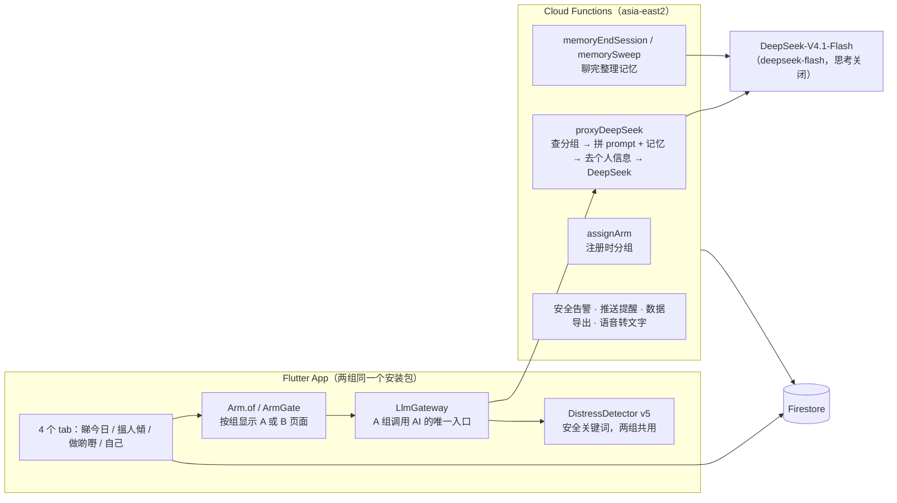

# 陪住 App 技术文档

> 最后核对：2026-10-04，`main` @ fa62c81 + 决策 0015 的改动；2026-10-07 补 T7 安全检测（决策 0018）、决策 0019（搜一搜、语音开关）、同意与删除（决策 0020）；T17 Phase A 的 ADA 和第 7 日开放题（决策 0026）；T17b ADA v1.0、第 7 日流程和电话补做（决策 0030）；2026-10-14 T21 研究期和登记门（第 4 节）；2026-10-14 第二次：决策 0037 六项过渡默认（`PHASE_B` 保留、`pilot` 指试跑）；2026-10-14 T25 会话定义和 Brief PR 第二版（第 6 节，开关默认关）。2026-10-14 T24 研究周和每周问卷流程（第 6.2 节、第 8、9 节；开关 `app_config/phase_b.weeklyScheduleV2Enabled` 默认关；PR 草稿）。代码改了，这份跟着改（同一个 PR）。 2026-10-14 T46 收尾按钮首次说明每台手机只显示一次（第 6.0 节；PR 草稿）。 2026-10-14 T40 使用事件记录（第 8、9、12 节；开关 `usageEventsEnabled` 默认关；PR 草稿）。 2026-10-14 T39 运营看板每人页（第 8、9、12 节；开关 `opsDashboardEnabled` 默认关；PR 草稿）。 2026-10-15 1014e 第 2 节第 7、8 条：Hybrid 回忆有效按条数、S10b 一律「頭先」、问卷按钮和首次说明定稿（第 6.0 节；PR 草稿）。 2026-10-15 1014e 第 2 节第 9 条：注册页删 UCLA 输入框（第 8 节；PR 草稿）。 2026-10-15 1014e 第 2 节第 11 条：研究员登记页右上角加「研究員儀錶板」入口（第 4 节「角色」；PR 草稿）。 2026-10-15 第 6 条文字定稿接入：规则组回忆页心情提示 S13、每周问卷 S14、首次说明 S10c（第 6.2 节；PR 草稿）。 2026-10-15 1014e 第 2 节第 3 条：`isTester` 只允许管理员写（第 4 节；PR 草稿）。 2026-10-15 1014e 第 2 节第 4 条：取消告警后备（第 9、10 节；PR 草稿）。 2026-10-15 1014e 第 2 节第 6 条：教育文章热线机构名更正（第 10 节；PR 草稿）。 2026-10-15 1014e 第 2 节第 1 条：`usage_weekly` 按 `endedAt` 归周（第 6.0 节；PR 草稿）。 2026-10-15 1014e 第 2 节第 12 条：评估员 W4 名单含 PILOT（第 4、9 节；PR 草稿）。
> 2026-10-15 T48：`closeContacts[].share`；研究员录入时 Hybrid 组的五题写成 `mem_facts`（每位陪伴者一份，`source_session_id: "intake"`，再录覆盖）；行动计划「同邊個」快捷按钮（第 4、8 节；PR 草稿）。注意：Phase B Hybrid 组走记忆 v1，App 的 `intake_memory_seeder` 只在 v0 跑。
> 2026-10-15 T47 入组问卷精简为五题、改由研究员在登记页录入，配对改为只记录老人自选（第 4 节、第 8、9、12 节；开关 `researcherIntakeEnabled` 默认关；PR 草稿）。
> 2026-10-15 翻页回页顶（分页 ListView 加 `ValueKey`）、键盘遮挡（固定列改可滚动、聊天列表 `reverse: true`）、字号合并封顶 1.3（`app.dart`）；PR 草稿。
> 2026-10-15 陪伴者页面顶栏统一（`lib/core/agents/companion_app_bar.dart`：左上收尾按钮、头像加名字标题、右上空；六个页面两组相同；PR 草稿）。
> 2026-10-16 `login_page.dart`：电邮 `maxLines: null` 加去空白的 formatter；建立帐号多一格 `login_password_again`（验证与第一格相同）；`login_show_password` 眼睛按钮控制两格的 `obscureText`。
> 2026-10-16 测试员自切组别（第 4 节「防护」、第 12 节；开关 `app_config/feature_flags.testerArmSwitchEnabled` 默认关；PR 草稿；决策草稿 `docs/decisions/NNNN-tester-arm-self-switch.md`）：新函数 `setTesterArm`（`functions/tester_arm.js`）只认 `isTester` 帐号、只改自己，写 `users.arm`（有 `enrollments` 就跟着改）、`armAssignedBy: "tester_switch"`，缺的 `cohort: "pilot"`／`armAssignmentMode: "pilot_designated"`／`w0Date` 补上，`arm_assignment_log` 记 `action: "tester_switch"`；`armFor` 不缓存测试员（参与者仍 10 分钟）；`memory.inScope` 和 App `MemoryModes` 对 Arm A 测试员视同正式 Hybrid 组，`memorySweep` 多查一组；`dispatchWeeklyBundles` 只给切过组的测试员排程；`tool/purge_tester_data.js` 仍把它当测试员；研究员面板人数不算测试员。App：测試員工具「切換組別（只限測試員帳號）」，按下后 `AuthService.reloadProfile` 重读帐号，`Arm.of` 立即跟着变。
> 最后核对：2026-10-04，`main` @ fa62c81 + 决策 0015 的改动；2026-10-07 补 T7 安全检测（决策 0018）、决策 0019（搜一搜、语音开关）、同意与删除（决策 0020）；T17 Phase A 的 ADA 和第 7 日开放题（决策 0026）；T17b ADA v1.0、第 7 日流程和电话补做（决策 0030）；2026-10-14 T21 研究期和登记门（第 4 节）；2026-10-14 第二次：决策 0037 六项过渡默认（`PHASE_B` 保留、`pilot` 指试跑）；2026-10-14 补 T34 安全告警邮件（开关 `meta/alert_config.enabled` 默认关；PR 草稿）。代码改了，这份跟着改（同一个 PR）。
> 最后核对：2026-10-04，`main` @ fa62c81 + 决策 0015 的改动；2026-10-07 补 T7 安全检测（决策 0018）、决策 0019（搜一搜、语音开关）、同意与删除（决策 0020）；T17 Phase A 的 ADA 和第 7 日开放题（决策 0026）；T17b ADA v1.0、第 7 日流程和电话补做（决策 0030）；2026-10-14 T21 研究期和登记门（第 4 节）；2026-10-14 第二次：决策 0037 六项过渡默认（`PHASE_B` 保留、`pilot` 指试跑）；2026-10-14 T37 登记后的入组引导顺序和“引导已完成”标记、显示设定本机保存（第 4 节末、第 12 节）；2026-10-14 T30 角色含义、评估员视图、Calvin 上传序列、过程/结局数据分开、锁库导出（第 4 节「角色」、第 8、9、12 节；PR 草稿，七个开关默认关）。代码改了，这份跟着改（同一个 PR）。
> 最后核对：2026-10-04，`main` @ fa62c81 + 决策 0015 的改动；2026-10-07 补 T7 安全检测（决策 0018）、决策 0019（搜一搜、语音开关）、同意与删除（决策 0020）；T17 Phase A 的 ADA 和第 7 日开放题（决策 0026）；T17b ADA v1.0、第 7 日流程和电话补做（决策 0030）；2026-10-14 T21 研究期和登记门（第 4 节）；2026-10-14 第二次：决策 0037 六项过渡默认（`PHASE_B` 保留、`pilot` 指试跑）；2026-10-14 T37 登记后的入组引导顺序和“引导已完成”标记、显示设定本机保存（第 4 节末、第 12 节）。代码改了，这份跟着改（同一个 PR）。 2026-10-14 T27 语音改走服务器 STT v2（`transcribeAudio`，只用 asia-southeast1 / chirp_2，重试 1 次，失败显示 S6 并记 `voice_transcription_failed`；开关 `voiceInputEnabled` 仍默认关；PR 草稿）。
> 最后核对：2026-10-04，`main` @ fa62c81 + 决策 0015 的改动；2026-10-07 补 T7 安全检测（决策 0018）、决策 0019（搜一搜、语音开关）、同意与删除（决策 0020）；T17 Phase A 的 ADA 和第 7 日开放题（决策 0026）；T17b ADA v1.0、第 7 日流程和电话补做（决策 0030）；2026-10-14 T21 研究期和登记门（第 4 节）；2026-10-14 第二次：决策 0037 六项过渡默认（`PHASE_B` 保留、`pilot` 指试跑）；2026-10-14 T37 登记后的入组引导顺序和“引导已完成”标记、显示设定本机保存（第 4 节末、第 12 节）；2026-10-14 T32 第 6 条：旧测试员数据批量清理脚本 `tool/purge_tester_data.js` 和服务器专用的运行记录 `admin_runs`（第 8 节“删除”；PR 草稿）。代码改了，这份跟着改（同一个 PR）。
> 读者：项目负责人、新加入的开发者。先读这份，再按需要读各专题文档。

## 1. 一句话

陪住是给香港长者用的粤语陪伴 App，有三个 AI 陪伴者。Phase B 是两组随机对照：**Hybrid 组**（规则 + LLM，下文也叫 A 组）和**规则组**（只有规则，下文也叫 B 组）。两组装同一个 App，界面一样，差别只在「回应是谁生成的」：A 组由 DeepSeek 生成，B 组用预先写好的粤语模板。

## 2. 系统组成



| 部分 | 技术 | 代码位置 |
|---|---|---|
| App | Flutter **3.35.3**（固定版本，见 `docs/dev/ci-cd.md`） | `lib/` |
| 服务器 | Firebase Cloud Functions v2，Node 24，区域 `asia-east2` | `functions/` |
| 数据库 | Firestore，项目 `loneliness-pilot-dev` | 规则 `firestore.rules` |
| 大模型 | DeepSeek-V4.1-Flash（请求 `deepseek-flash`，`thinking` 关闭，决策 0017），经 `proxyDeepSeek` 调用，API key 只在服务器上 | `functions/index.js` 的 `DEEPSEEK_MODEL` |
| 语音转文字 | T27 起：App 录音（16 kHz 单声道，只在内存，不落盘），上传到服务器 `transcribeAudio`，由 Google Cloud Speech-to-Text v2（模型 `chirp_2`，区域 **只用 `asia-southeast1`**，不退 `global`）转写，文字填进输入框；不再用手机系统识别（`speech_to_text` 已删）。服务器失败自动重试 1 次，仍失败 App 在输入框旁显示 S6，不进聊天、不进记忆，记 `voice_transcription_failed`。**Phase B 默认关**（第 12 节） | `lib/core/voice/`（`voice_input_button.dart`、`voice_recorder.dart`、`wav_encoder.dart`、`transcription_repository.dart`、`voice_copy.dart`）、`functions/stt.js`、`functions/index.js` `transcribeAudio` |
| iOS 发布 | Codemagic | `codemagic.yaml` |
| 测试和部署 | GitHub Actions | `.github/workflows/` |

## 3. 三个陪伴者和各模块

| 陪伴者 | 角色 | 主要模块 |
|---|---|---|
| 小欣 `siu_yan` | 每日签到、情绪 | M2 签到、M5 反思、M6 社交建议 |
| 阿珍 / 阿伯 `ah_jan_ah_bak` | 回忆、倾偈（老人在 onboarding 选性别版本） | M3 回忆（每周主题）、自由对话 |
| 通通 `tung_tung` | 好奇、闲聊、资讯 | 通通聊天、M8 文章问答 |

Persona 设定在 `functions/prompts/`：小欣、阿珍/阿伯用 `*_v1.txt`；通通用 `tung_tung.v2.txt`（App 仍发 `tung_tung_v1`，服务器按 `functions/index.js` 的 `PROMPT_FILES` 换成 v2，决策 0019）。旧文件保留不改。

**两组各模块对照**

| 模块 | Hybrid 组（A） | 规则组（B） |
|---|---|---|
| M2 小欣签到 | LLM 对话 + 记忆 | 心情脸 + 3 道选择题 + 一段文字（`check_in_arm_b.dart`）；开关 `RULE_TEMPLATE_REPLIES` 开时，提交后按心情给一条模板回应（决策 0023，默认关） |
| M3 阿珍/阿伯回忆 | LLM 对话 + 周摘要 | 固定主题开场 + 一个输入框（`reminiscence_arm_b_page.dart`）；开关开时多一个选填心情脸，提交后按五档心情给一条模板回应，哀伤内容用 Z5（决策 0023、0032，默认关） |
| 阿珍/阿伯自由对话 | LLM | **入口隐藏**（决策 0006） |
| 通通 | LLM 闲聊 + 文章问答（网络搜索默认关，决策 0019） | 同一页面，开场题库每天换一条，回应按 10 类话题从模板选（`tung_tung_rule_responder.dart`，决策 0005） |
| M5 反思 | 按上下文生成题目 | 固定题库轮换 |
| M6 社交建议 | 个性化 | 16 条建议池 |
| M7 行动计划 | LLM 辅助 | 模板 |
| M8 文章 | 多一个「問通通呢篇」按钮 | 无该按钮 |
| M9 进度 | 多一张 LLM 周小结卡 | 无该卡 |
| 首页个性化问候、跨陪伴者转介 | LLM 生成 | 不出现 |
| 跨会话记忆 | 有（决策 0001、0007） | 无 |
| 安全检测、问卷、推送 | 相同 | 相同 |

页面按组切换的方式：`ArmGate(armA: …, armB: …)`，或者页面内 `Arm.isA(context)`（`lib/core/arm/arm_scope.dart`）。

## 4. 分组和 cohort

**分组（arm），T19 起（决策 0029）**：Phase B 的分组由非盲研究员登记触发，不再在注册时自动分。

1. 老人先在自己手机上注册（研究员在旁协助）。这时 `arm` 为空，App 显示规则组界面（决策 0004）。
2. 非盲研究员（Auth 角色 `unblinded`）用自己的账号登录同一个 App，登录后直接进「研究員登記」页（`lib/features/enrollment/`）。填老人的登入电邮、研究编号、W0 纸本 DJG 情感分（0–3）、阿珍/阿伯、W0 日期 → 「檢查」（服务器试运行：找到账号、显示名字，不显示组别）→ 确认框里再选一次情感分，两次一致才能提交。
3. Cloud Function `enrollParticipant`（`functions/randomization.js`）在一个事务里：按情感分分层（0–1 低层、2–3 高层），取该层分配序列的下一个未用位置，写入 `users/{uid}`：`arm`、`strataCell`（0 低 / 1 高）、`armAssignmentMode: "randomise"`、`armAssignmentMethod: "permuted_block_v1"`、`armAssignedBy: "server"`、`armAssignedAt`、`w0Date`（T47 起**不再写** `ahJanAhBakVariant`：配对是老人在引导里自己揀的，登记只把当时老人已选的记进 `enrollments.companionVariant`，没选就记空）；同时写登记记录 `enrollments/{uid}`、研究编号对照表、分配日志 `arm_assignment_log`（研究编号、层、序列位置、时间、操作的研究员）。
4. 组别只在研究员的登记页显示，用于按组引导。老人完全关闭 App 再打开后，新组别生效。

**研究期按研究编号前缀，T21 起**（登记表 v8 C01；Phase A 暂停，决策 0034）：登记页按编号开头决定填什么，服务器再查一次（`functions/study_period.js`）。

| 编号 | 研究期 | 登记时填 | 组别怎样来 | 研究日从哪天算 | 日志 |
|---|---|---|---|---|---|
| `PB-…` | Phase B：`users.cohort = "phase_b"`，`enrollments.studyPeriod = "B"` | W0 情感分、阿珍/阿伯、W0 日期 | 分配序列（上面第 3 步） | W0 日期 | `arm_assignment_log` |
| `PILOT-…` | 试跑：`users.cohort = "pilot"`，`enrollments.studyPeriod = "PILOT"` | 阿珍/阿伯、版本（Hybrid 或规则组，确认框里再选一次） | 研究员指定，不占序列；`armAssignmentMode: "pilot_designated"` | 登记日（写进 `w0Date`） | `pilot_assignment_log`（编号、版本、时间、操作人） |
| `PA-…`、没有前缀 | 登记时拒绝（`research_id_prefix`） | — | — | — | — |

- `cohort` 用决策 0011 的字段，只有服务器能写。试跑的 Hybrid 账号和 Phase B 的 Hybrid 一样有服务器记忆（`memory.js` `inScope`、App `MemoryModes`）；试跑不进盲法导出，也不收旧的 Phase A 第 2 周推送（`week2Push`）。
- **测试账号标记 `users/{uid}.isTester`**（10/15 1014e 第 2 节第 3 条，backlog 96）：**只有管理员能写**——规则拒绝客户端新建或改动这个字段，App 的 `toMap` 不再带它，设置页的测试员开关改为只读说明；用 `tool/set_tester.js --uid=… --tester=true`（登记过的账号要加 `--allow-registered`）或控制台设置。登记门打开前要给团队和评估员账号设上。
- **登记门**（开关 `app_config/feature_flags.enrollmentGateEnabled`，默认关）：开时，没有 `cohort`、也不是测试账号（`isTester: true`）的账号，App 只显示等待页 S8（`lib/features/enrollment/presentation/enrollment_wait_gate.dart`，放在同意页之前）；服务器拒绝它的 LLM 调用，`llm_denied_log` 记 `reason: "not_enrolled"`；Firestore 规则不让它写 `users/{uid}/` 下的研究数据（推送令牌 `fcm_tokens` 除外，用户文档本身照常）。关时和以前一样。

**入组问卷（T47，`docs/dev-tasks/dev-tasks-1015-intake.md`）**：原来注册后的 6 页「入組問卷」（10–15 分钟）老人答得吃力，10/15 定为五题（想 app 帮到乜、重要的人、平时钟意做乜、唔想提起的话题、打字定讲），由研究员在 W0 面访口头问、在登记页「入組資料」录入（`recordResearcherIntake`，开关 `researcherIntakeEnabled`）。答案只用于个人化：`mainGoals` 进三位陪伴者的首次记忆、`interests` 给通通（和老人在引导里自选的兴趣是同一个字段，后录入的覆盖）、`closeContacts` 里老人同意分享的（T48 `share`）给小欣和行动计划快捷按钮、`avoidTopics` 作「唔好主動提起」。**T48 起这些在 Phase B 由服务器写成记忆条目**（App 的播种只在记忆 v0 跑；Phase B Hybrid 组是 v1）。规则组不读 intake 的任何字段（模板回应只看陪伴者和心情），行动计划的快捷按钮两组都有，两组相同。原 6 页里的作息、心事、想重新联系的人、人生阶段、偏好时段等字段不再收集，旧数据原样留在文档里，没有读取方。

**登记后的入组引导顺序（T37，开关 `app_config/feature_flags.onboardingAfterEnrollmentFix`，默认关）**：登录后 App 的门按顺序是 `StaffGate`（研究员去登记页）→ `EnrollmentWaitGate`（登记门，上面）→ `ConsentGate`（同意页 → 入组问卷 → 「介紹三個夥伴」引导）→ 主页（`lib/features/auth/presentation/pages/auth_gate.dart`、`lib/features/consent/presentation/consent_gate.dart`）。引导要不要做，以前只看“有没有阿珍/阿伯配对”；登记也写配对，所以“先登记后引导”会整段跳过。开关开时改为看标记 `users/{uid}.onboardingCompletedAt`（老人按「完成」时 App 写，开关关着也照写）：有标记就不做；没标记、没配对就做；没标记、有配对：没登记过的算做过（配对只能是 App 写的），登记过的只有当 App 留有自己的痕迹（`consent.transcriptRetentionByAgent` 三个键，只有 App 的「完成」会写）才算做过，否则做。引导里的配对一屏预选登记值；老人改选时 App 记一条 `events`（`ah_jan_ah_bak_changed`：from、to、at、where），`enrollments/{uid}` 里的登记值不动，分析以它为准（T30 以后把这条日志搬到服务器）。开关关时和以前完全一样。

**分配序列**：每层一条，1:1 置换区组，区组大小 2 和 4 随机混用，每层至少 60 个位置。由非盲研究员用自己选的种子运行 `tool/randomization_sequence.js` 生成，上传到 `randomization_sequences/{low,high}`；种子和序列文件只存在本地 `randomization-private/`（不进仓库），交导师离线保存。上传不带种子。

**重复提交**：同一个账号再提交，返回原来的组别，不再随机，记一条 `resubmit` 日志。**更正**：只能用 `tool/correct_arm_assignment.js`，必须写理由，记 `correction` 日志。

**`assignArm`**（`functions/arm.js`）：App 注册和登录时仍会调用。T19 起它只做两件事：有组别就返回；`meta/randomization_config.enabled` 关着时给 Phase A / pilot 账号 A 组（`force_a`）。开关开着时什么都不分。旧的最小化分配（UCLA × 年龄 4 层、`meta/arm_counter` 计数）已删除；`app_config/arm_assignment.randomise` 已停用（开关关着时它为 true 会拒绝分组，免得把 Phase B 的人误分进 A 组）。

**防护**：

- 分组字段（`arm`、`strataCell`、`armAssignmentMode`、`armAssignedBy`、`armAssignedAt`，T19 加 `w0Date`、`armAssignmentMethod`、`armCorrectedAt`，T21 加 `cohort`）只有服务器能写：客户端建档时不能带，之后不能改、不能删；客户端也不能删自己的用户文档，免得删档重建换组（Firestore 规则，决策 0022）。
- `proxyDeepSeek`、`referralJudgement`、`webSearch` 每次先查分组，B 组直接拒绝，并在 `llm_denied_log` 记一条（uid、哪个接口、时间；不存文字）。即使 App 哪里判断错了，B 组也拿不到 LLM。服务器的分组缓存 10 分钟过期，更正后最迟 10 分钟生效。
- 分组还没拿到（`arm` 为空）时 App 显示 B 组界面（决策 0004），下次登录自动重试。登记前的这段时间服务器不拒绝 LLM（App 不会调用），见决策 0029。T21 的登记门打开后，这段时间改为只显示等待页，服务器也拒绝（见上）。
- 序列、指针、登记记录、分配日志、试跑日志 `pilot_assignment_log`、`meta/randomization_config`、`meta/arm_counter`：客户端（老人、盲法、非盲人员）一律不能读写。

**角色**（Auth custom claims，`tool/provision_researcher.js`；T30 按 10/14 分工重定，决策草稿在 T30 报告第 9 节）：

| 角色 | 给谁 | 能做什么 |
|---|---|---|
| `unblinded` | Junyu | 登记、看组别、读研究编号对照表、安全告警、后台两组人数和单组板块、过程数据导出、全体合并完成率。**入口**（10/15 1014e 第 2 节第 11 条）：登录直接进「研究員登記」页，右上角两个按钮进「研究員儀錶板」（T34 告警和確認處理、T30 完成率）和「營運看板」（T39，开关开时）。**不生成、不看序列**（规则不让任何客户端读序列；上传函数只认 `sequence_uploader`） |
| `blinded` | W4 结局评估员 Keran、后备 Mingyan Wang | 只有评估员视图：登录直接进 W4 到期名单和纸本 DJG-ES 录入（`lib/features/assessor/`），在登记门和同意页之前，不收参与者推送（`FcmService.suppressForStaff`）。规则里**零读权限**，名单和录入都走函数 `assessorDueList` / `submitOutcomeEntry`（`functions/assessor.js`），只回研究编号、窗口、第几天、录没录、超没超窗；分数服务器算，存 `outcome_entries`，评估员看不到。开关 `app_config/feature_flags.assessorViewEnabled`（默认关，关时 `blinded` 进普通 App） |
| `unblinded` | Junyu | 登记、看组别、读研究编号对照表、安全告警、后台两组人数和单组板块、过程数据导出、全体合并完成率。**不生成、不看序列**（规则不让任何客户端读序列；上传函数只认 `sequence_uploader`） |
| `blinded` | W4 结局评估员 Keran、后备 Mingyan Wang | 只有评估员视图：登录直接进 W4 到期名单和纸本 DJG-ES 录入（`lib/features/assessor/`；10/15 1014e 第 2 节第 12 条起名单含 `PILOT-`，录入也接受；全体合并完成率仍只算 Phase B），在登记门和同意页之前，不收参与者推送（`FcmService.suppressForStaff`）。规则里**零读权限**，名单和录入都走函数 `assessorDueList` / `submitOutcomeEntry`（`functions/assessor.js`），只回研究编号、窗口、第几天、录没录、超没超窗；分数服务器算，存 `outcome_entries`，评估员看不到。开关 `app_config/feature_flags.assessorViewEnabled`（默认关，关时 `blinded` 进普通 App） |
| `sequence_uploader` | Calvin | 在自己电脑生成序列（`tool/randomization_sequence.js`），用自己的登录调 `uploadRandomizationSequence`（`functions/sequence_upload.js`）上传；规则里零读权限。开关 `meta/randomization_config.sequenceUploadEnabled`（默认关）；两层任何一层已有人分配就拒绝；每次写 `sequence_upload_log`（长度、指纹、账号；没有组别、没有种子） |

旧名字 `pi`、`researcher` 不再有任何权限。

**结局数据和过程数据（T30）**：锁库前 `unblinded` 看不到任何结局数值：`outcome_entries`、`outcome_entry_corrections`、`weekly_status`（`w4VisitDate` 给 T24）、`allocation_records`、`pairing_change_log`、`meta/data_lock`、三个导出日志都只有服务器能读写；后台只给全体合并完成率（`outcomeCompletionSummary`，少于 5 人不显示，开关 `outcomeCompletionSummaryEnabled`）。过程数据（Brief PR、Weekly PR、使用量、会话层、安全事件带来源）按研究编号 + 真实组别导到 Storage `exports_process/{日期}/`（`functions/process_export.js`，开关 `meta/blinding_config.processExportEnabled`）；`outcomeExportPaused` 开后不再写 `exports_v2`。锁库和分析导出：`tool/analysis_export.js`（`--lock` 写 `meta/data_lock`，二次确认；没锁拒绝导出；`--synthetic` 生成同表同列的 72 人合成数据）。更正评估员录入：`tool/correct_outcome_entry.js`（理由 + `outcome_entry_corrections`）。整人删除加 `--allocation-record`：保留 `allocation_records/{研究编号}` 一行（无 uid、姓名、联系方式），删掉带 uid 的分配日志行。配对改动：`onUserPairingChanged` 在开关 `pairingChangeServerLogEnabled` 开时写 `pairing_change_log`（登记值 `enrollments.companionVariant` 不动）。

**给 PI 的告警**（T19）：`pi_alerts` 和发给 `PI_EMAIL` 的邮件不再带 `source`、`inputPoint`、`agentId`（这些值有的只有一组才有），只带研究编号、级别、时间、告警编号；两组完全相同，每条 acute 事件照旧告警（`functions/pi_alert.js`）。

**编译开关**：现在 Phase B 界面靠 `--dart-define=PHASE_B=true` 打开，不加就是「所有人显示 A 组」的 Phase A 包。决策 0011 原定改成 `cohort` 字段并删掉这个开关；**10/14 决策 0037 第 1 项暂定保留**（待负责人确认）：Phase A 暂停后，参与者包固定用 `PHASE_B=true`（Build APK 的 `phase_b` / `phase_b_templates` 选项），Phase A 专用行为在这个包里由 `AdaGate` 等关住。以后要删或改成按研究期在运行时判断，另开任务（T21 报告第 5 节列了 8 个文件）。

**cohort（决策 0011，T21 起由登记写入；`pilot` 的含义见决策 0037）**：`users/{uid}.cohort` = `phase_b`（`PB-`）/ `pilot`（`PILOT-` 试跑）；`phase_a` 暂不会出现（Phase A 暂停）。决策 0011 里“现有全部账号标 `pilot`”没有做、也不再做（0037 第 2 项）：旧账号是测试员的，按 T32 的清理脚本删除，不标记。

**W0 日期**：App 的 `w0DateFor`（`lib/core/scheduling/w0_date.dart`）和服务器的 `w0DateKey`（T24 起在 `functions/study_week.js`；`functions/djg_w2.js` 的同名函数只是转调）先用登记时写的 `w0Date`，没有再用账号的 `createdAt`。**研究周**（T24）：W0 当天是第 0 天，第 k 天属于第 ceil(k/7) 周（第 1–7 天 = 第 1 周）；服务器 `functions/study_week.js`、App `lib/core/scheduling/study_week.dart`，两边用同一张测试表 `test/fixtures/study_week_table.json`。T34 告警邮件的「研究第几天」已改用这个函数。

## 5. 一条消息的旅程（A 组）

1. 老人在聊天页输入（文字；语音默认关，见第 12 节）。
2. `LlmGateway` 先用统一入口 `SafetyService`（`lib/core/safety/safety_check.dart`，内部是 `DistressDetector`）查输入：
   - **acute（急性）**：不调模型，显示热线，打开紧急支援页；
   - **moderate_interrupt**：照常回复，同时打断显示支援模板；
   - **moderate_review**：照常回复，事后供研究员查看；
   - 以上都写 `safety_events`（`source`、`inputPoint`、`turnId`），服务器 `onSafetyEventCreated` 去重、acute 通知 PI。
3. 调 `proxyDeepSeek`：
   - 查分组（B 组拒绝）；
   - 读 persona prompt 文件，接上 App 传来的上下文（`contextSuffix`）；
   - 记忆 v1 用户：服务器自己读记忆、拼进 prompt（见第 7 节）；
   - prompt 末尾加「不写电话号码」规则 `hotline_rule.v1`（开关 `meta/safety_config.hotlinePromptRule`）；
   - `stripPII` 去掉电话、邮箱、身份证等；
   - 调 DeepSeek，计算 5 个「LLM 独有机制」标记（`functions/llm_flags.js`）；
   - 在 `llm_calls` 记一条：返回的 `model`、token 数、延迟（见第 11 节）；
   - 回复里的电话号码全部换成「【緊急熱線】」，每次替换记一条 `hotline_filter_log`（开关 `hotlineOutputFilter`）。
4. 回复再查一次安全词（只在级别高于输入时写事件，一轮只算一条），App 再过一遍号码过滤，然后显示。「【緊急熱線】」显示成链接，点开是危机页。
5. 记录：每轮写 `turns`，每次会话写 `sessions`（`ChatSessionRecorder`）；没有被安全标记的轮次写进记忆缓冲区。
6. 离开页面：会话结束 → 整理记忆 → 满足条件时弹 Brief PR（见第 6 节）。

**B 组**：同样的页面外壳，第 2 步一样（同一个 `SafetyService`）；第 3 步换成本地规则选模板，`turns` 里标 `llmStatus: rule_based`。不调 LLM，不写记忆。

**B 组签到、回忆的模板回应**（决策 0023、0032，开关 `RULE_TEMPLATE_REPLIES`，默认关）：提交时先做安全检测。没命中：从 `lib/features/rule_replies/data/rule_reply_pool.dart` 按「陪伴者 × 心情档（五档）」选一条，回忆没选心情用 G-1。回忆命中 `moderate_review`（哀伤、旧日艰难）：不看心情，从 Z5 选，同时照常走安全流程。命中 `moderate_interrupt`、`acute`（签到还有 `moderate_review`）：不给模板，只走安全流程。近 3 次不重复（记录在 `users/{uid}/rule_reply_history/{agentId}`），写进 `turns` 的回复，记分析事件 `rule_template_reply`（`template_id` 用定稿编号 X1-1 … G-1）。41 条文字照抄 `docs/spec/copy/rule-templates.md`（`test/final_copy_test.dart` 逐字比对）。模板里还有【占位】文字时，开关打开也不生效，除非另加 `RULE_TEMPLATE_REPLIES_ALLOW_PLACEHOLDER=true`（只用于截图和测试）；定稿后已没有占位。

**定稿短文字**（T33，`docs/spec/copy/short-texts.md`）：S1a 通通固定回应（`tung_tung_search_intent.dart`）、S3 人生點滴入口（`reminiscence_landing.dart`）、S4a 行动计划提醒推送正文（`functions/reminders.js`）、S2「唔好記住」确认句（`functions/prompts/memory_forget_ack.v2.txt`）、S5 使用建议（入组引导最后一屏，`agent_onboarding_page.dart` `_UsageAdviceSlide`，开关 `app_config/usage_copy.onboardingUsageAdviceEnabled`，默认关；关时引导仍是 4 屏）。开关都没变。

## 6. 会话和 Brief PR

| 项目 | 现在的实现 | 位置 |
|---|---|---|
| 会话开始 | 聊天页里**第一条用户消息**发出时（不是打开页面时） | `lib/core/session/chat_session_recorder.dart` |
| 会话结束 | 离开页面（`user_left`）；**10 分钟**没有新消息（`timeout`）；触发 acute（`crisis`）；App 被杀掉的，下次启动补记 `app_killed` | 同上；分钟数在 `PhaseAConfig.sessionIdleTimeoutMin` |
| Brief PR 弹出（聊天页） | 离开聊天页时，本次会话用户发言 **≥2 轮**且不是 crisis 结束 | `lib/features/brief_pr/data/brief_pr_gate.dart`；轮数在 `PhaseAConfig.briefPRMinTurns` |
| Brief PR 弹出（签到 B、回忆 B） | 每次提交算一次会话，提交后弹出，acute 结束的不弹（决策 0015） | `lib/features/brief_pr/data/rule_submission_flow.dart` |
| Brief PR 出现的页面 | 两组的签到、回忆、通通；A 组的自由对话 | 各页面 |
| 首次 Brief PR | 每个陪伴者第一次弹出时没有「跳过」按钮（anchor） | `isAnchorPromptFor` |

签到 B 和回忆 B 也写 `sessions` 和 `turns`（`llmStatus: rule_based`），`moduleId` 和 A 组相同，所以两组的使用量可以直接比较。

### 6.0 第二版（T25，登记表 C14、C16；开关 `app_config/phase_b.sessionBriefPrV2Enabled`，默认关）

上表是开关**关着**时的行为（现状）。开关打开后（Phase B 和试跑，两组相同），改成下面这样；规则在 `lib/core/session/session_rules.dart`，报告 `docs/dev-reports/T25-session-briefpr-20261014.md` 有字段表。

| 项目 | 开关打开后 | 位置 |
|---|---|---|
| 会话结束 | 收尾按钮 S9「今日傾到呢度」（`close_button`）；返回键 / 手势（`back`）；另一位陪伴者开始会话（`switch_agent`）；**30 分钟**没有新消息（`timeout`，`sessionIdleTimeoutMinV2`）；acute（`crisis`）；App 被杀掉的下次启动按已存消息补判（`recovered`，不再是 `app_killed`）。切 App、锁屏只暂停计时。收尾按钮第一次出现时的一句说明（【占位】）**每台手机只显示一次**（T46：标记存在本机 `shared_preferences`，键 `session.closeHintShown`，`main()` 启动时读回；不进 Firestore；存储读不到时退回 T25 的每次启动一次） | `chat_session_recorder.dart`、`idle_session_timer.dart`、`session_close_button.dart`、`session_close_hint.dart` |
| 有效会话 `isValid` | 自由聊天（通通、反思对话）≥3 条**有回复**的消息（`freeChatValidMinUserMessages`）；Hybrid 签到 = 记录了心情 + ≥1 条有回复（`hybridCheckInValidRequiresMood`、`hybridCheckInValidMinUserMessages`）；Hybrid 回忆 = **≥3 条有回复的消息**（10/15 1014e 第 2 节第 7 条：`hybridReminiscenceValidRequiresSave` 默认改为 false；设为 true 才要求按「儲存」）；签到 B、回忆 B = 一次完整提交（`submitted`，决策 0015）。fallback 和危机短路的回合不算回复 | `SessionRules.isValid` |
| 会话日志新字段 | `sessionType`、`userMessageCount`、`replyCount`、`lastReplyAt`、`isValid`、`moodRecorded`、`summarySaved`、`isRuleSubmission`、`ruleSubmissionCompleted`、`briefPrInvitedTodayAlready`、`briefPrSkippedByCap`、`scheduleVersion`（1 旧 / 2 新） | `users/{uid}/sessions/{id}` |
| Brief PR 邀请 | 只在有效会话结束后，由 `BriefPrScheduler` 决定：每位陪伴者每天最多 1 次（`briefPrDailyCapPerAgent`，超过的不建记录、会话行标 `briefPrSkippedByCap`）；危机结束或处置中不邀请（记录 `due_not_invited` + 原因）；不再在聊天页弹窗，也没有主动评价入口 | `lib/features/brief_pr/data/brief_pr_scheduler.dart` |
| 评价卡 | 「搵人傾」列表页顶部一张卡：收尾 / 返回 / 切换结束的用 S10a，超时 / 被杀掉的下次打开用 S10b（10/15 起时间说法一律「頭先」，不再有【占位】和 `copy_pending`）；按钮「好呀」「今次唔評」≥48×48；不遮挡陪伴者卡片和返回。距最后一条完整回复 >2 小时过期（`briefPrCatchUpExpiryHours`） | `brief_pr_invite_card.dart`、`brief_pr_card_host.dart`（放在 `talk_page.dart`） |
| 问卷 | 「好呀」才打开：一题一屏、显示 1/4、七个选项整行可按、「下一題」「完成」分开、「上一題」、「唔評住」（10/15 定稿，S10c）。题目和 1–7 分不变，2、3、5、6 分只显示数字（已定） | `brief_pr_flow_page.dart` |
| Brief PR 记录 | `users/{uid}/brief_pr/{sessionId}`（文档编号 = 会话编号，重复提交不可能），`schemaVersion: 3`；`finalStatus` = `completed` / `partially_completed` / `skipped` / `expired` / `due_not_invited`，`everShown`，`inviteChannel` = `list_page` / `catch_up`，四题原始分不反转。旧的弹窗记录（`schemaVersion: 2`）照旧可读 | `brief_pr_record.dart`、`brief_pr_store.dart` |
| anchor 规则 | 取消：每张卡都有「今次唔評」 | — |
| 记忆 | 不变：会话结束时交给记忆（Hybrid 组），不等评分；评分永远不进记忆 | 各页面的 `RollingSummaryCompiler` 调用 |
| `llm_calls` | 每条带 `session_id`（App 传的会话编号；服务器自发的调用为空） | `functions/llm_log.js` |
| 每人每周有效会话数 | 导出 `usage_weekly` 多一列 `validSessionCount`（`sessions.isValid == true`）；没有单独的汇总表，查询见 T25 报告。**归周按会话结束时间 `endedAt`**（10/15 1014e 第 2 节第 1 条；没有 `endedAt` 的行退回 `startedAt`），行上带 `weekBasis: "endedAt"`；盲法导出和过程数据导出同一规则 | `functions/blinding.js` `sessionWeekAnchor`、`functions/process_export.js` |

### 6.1 Phase A 的 ADA 和第 7 日问卷（决策 0026、0030，默认关）

- **只在 Phase A 构建**：`PHASE_B=true` 的包里永远不出现（`lib/features/ada/data/ada_gate.dart`）。Phase A 包里也要研究侧在 `app_config/phaseA_schedule` 打开（`adaEnabled`、`day7OpenEndedEnabled`）才出现。
- **ADA**（`lib/features/ada/presentation/ada_page.dart`）：题目照抄 `docs/spec/instruments/ada.md`（`ada_items.dart`，版本 `ada-v1.0-20261007`）。一屏一项：A 一屏（只有全版）；B 每句一屏、三个陪伴者同屏打分；C 每个情境一屏（只有全版）；D 长文字一屏；第 1 次到访最后一屏选第 7 日提醒时间。名字旁有头像，阿珍/阿伯按 `ahJanAhBakVariant`。可返回，每屏保存，默认可跳过（记 `"skipped"`）。不算总分。
- **时间点**：`adaTimepoints` 列出编号、短版/全版、入组第几天到第几天。默认 `visit1` 第 1 天短版（B + D），`day7` 第 7–9 天全版（A + B + C + D）。
- **第 7 日流程**（`day7_flow_page.dart`）：一张首页卡"第 7 日問卷"。开头说明部分数和预计时间（`day7FlowMinutes`，没配置显示【占位】），然后第 1 部分 ADA 全版、第 2 部分开放题（`day7_open_page.dart`），每部分顶上"第 N 部分，共 M 部分"。每部分单独保存，下次从没交的部分、停下的那屏继续。窗口用 `day7` 时间点的天数。
- **求助**：每屏"唔識填？打俾研究員"（`ada_widgets.dart`），号码 `adaHelpPhone`；没配置时不拨号，弹一句说明。
- **推送**（`functions/ada.js`，定时函数 `adaDay7Dispatch`，每小时 08:00–21:00）：窗口第一天到老人选的整点推一次（visit1 文档 `day7ReminderTime`，没选用 `adaDay7ReminderDefaultTime`），`adaDay7ReminderHours`（24）小时后没做完再推一次，过窗口记已超时。推送文字带【占位】不发。只推 Phase A 参与者，不推测试账号。
- **服务器状态** `ada_status/{uid}`：第 7 日状态（未开始 / 进行中 / 已完成 / 已超时）、推送和超时时间、研究编号（从 `research_id_map` 抄，只读不新建）。触发器 `onAdaResponseWritten`、`onDay7OpenResponseWritten` 保持最新。客户端不能读写。
- **研究员页面**（`ada_staff_page.dart`，研究员后台进入）：callable `adaStaffDay7Status` 列出每个 Phase A 参与者的状态；"電話代填"用同样的页面，经 `adaStaffLoad` / `adaStaffSave` 读写，服务器盖 `channel: "phone_by_staff"` 和研究员 uid，并用词库检查代填文字、命中写 `safety_events`。要 `role: blinded` 或 `unblinded`（决策 0029）；研究编号只给 `unblinded` 看。
- **旧的“陪伴者区分评估”**（`agent_diff`，第 14、28 天）：Phase B 包默认不显示（开关 `LEGACY_AGENT_DIFF_PHASE_B`）；Phase A 包在 `adaEnabled` 打开后不显示，关着时和以前一样。旧数据不动；不进新版盲法导出（T22，列在“揭盲前不导出”里）；旧版导出（盲法开关关着时）和 `tool/admin_dump.js` 仍会导出。

### 6.2 研究周和每周问卷流程（T24，登记表 C15 / C17；开关 `app_config/phase_b.weeklyScheduleV2Enabled`，默认关）

开关关着时和现在一样：Weekly PR / PGIC 按日历周（星期日 20:00 开窗到星期二），T18 的第 14 天单次 DJG 照旧。打开后（Phase B 包 + 登记过的 `cohort`：`phase_b` 或 `pilot`）：

| 项目 | 现在的实现 | 位置 |
|---|---|---|
| 排程（正式） | W1–W3：第 7、14、21 天 `weeklyPushHour`（默认 20:00）推送，推送那一刻起 `weeklyWindowDays`（3）× 24 小时内可答（第 10 天 20:00 关）；W4：第 26 天开，第 `week4CloseDay`（29）天结束关（T30 合并后再延到 W4 面访当天结束，钩子 `week4CloseFor(w0Date, w4VisitDate)` 现在都传 null）；W5–W7：第 35、42、49 天只推 PGIC，3 天窗口。W8 由 T35 做 | 服务器 `functions/weekly_schedule.js`（`bundlesFor`、`windowFor`、`openBundleAt`）；App `lib/core/scheduling/weekly_schedule.dart` 同一算法；同一张表 `test/fixtures/weekly_schedule_table.json` |
| 排程（试跑） | **10/15 起和正式完全一样**：`cohort: pilot` 也走上面的正式排程，`scheduleMode: standard`。原来的压缩排程（第 1、3、5、7 天、1 天窗口，配置 `pilotBundleDays` / `pilotWindowDays`）不再对应任何 cohort，只留在共用表测试里 | 服务器 `scheduleModeFor`、App `modeForCohort` |
| 流程 | 一个入口（首页卡片）→ 开头说明（共几部分）→ 各部分：DJG-ES 6 题（只在 `djgWeeks`）→ Weekly PR → PGIC → 社会接触探针（只在 `socialContactProbeEnabled` 开时，题目 S12）。每部分顶上「第 N 部分，共 M 部分」，分开保存，中途停下再进来从第一个没做完的部分继续。两组同一个页面，不看分组，没有 LLM | `lib/features/weekly_bundle/presentation/weekly_bundle_flow_page.dart`（T35 直接复用）、`social_contact_probe_page.dart`；DJG / Weekly PR / PGIC 页面加了 `part` / `bundle` 参数 |
| 记录 | 每部分一份，文档编号 = 周次（`W1`…`W7`）：`djg_responses/{W1\|W2\|W3}`（T18 结构，服务器算分）、`weekly_pr/{Wn}`、`pgic/{Wn}`、`social_contact_probes/{Wn}`（q1、q2 各 0–3）。App 写答案、`bundle`、状态、时间；服务器写 `studyWeek`、`studyDay`（推送那天）、`submittedStudyDay`、`pushedAt`、`windowStart`、`windowEnd`、`missed`、`scheduleMode`（触发器 `onWeeklyPrWritten` / `onPgicWritten` / `onSocialContactProbeWritten` / `onDjgResponseWritten` 调 `stampPartRecord`），规则拒绝客户端写这些字段 | `functions/weekly_schedule.js` `stampPartRecord`、`firestore.rules` |
| Brief PR 的周次 | `brief_pr` 记录按会话结束时间（T25 的 `sessionEndedAt`，旧记录退回 `respondedAt`）补 `studyWeek`、`studyDay`（触发器 `onBriefPrWritten`，开关开时） | `functions/weekly_schedule.js` `stampBriefPr` |
| 推送、提醒、缺失 | 定时函数 `weeklyBundleDispatch`（每小时 08:00–21:00）：窗口一开按人推（`fcm_tokens`，不广播）；安静时段不发、下一小时再试（`functions/quiet_hours.js`）；T18 的规则：推送后 `djgW2ReminderHours`（24）小时还有部分没交提醒一次；窗口过后每个没交的部分写一份 `status: missed` 记录（只在关窗后 7 天内补，避免开关中途打开时把早已过去的周全记缺失）。推送文字 10/15 定稿（S14），开关打开即发；带【占位】的覆盖文字仍不发。两个开关同时开时本函数说了算：`djgW2Dispatch` 不再发第 14 天推送 | `functions/weekly_schedule.js` `dispatchWeeklyBundles`、`markMissedParts` |
| 服务器状态 | `weekly_status/{uid}`：研究编号（从 `research_id_map` 抄）、每周的推送 / 提醒 / 缺失时间和窗口。客户端不能读写（研究编号不进老人能读的文档，决策 0021） | `firestore.rules`、`tool/delete_participant.js` 会删 |
| 旧的星期日推送 | 开关开时 `weeklySurveyReminder` 不再广播，改为按人发给不在研究周排程里的账号（不是 Phase B / 试跑、不是测试员、登记门关着）；开关关时照旧广播 | `functions/index.js` |
| 旧的每周孤独探针 | 没有任何页面挂它（`lib/features/loneliness_probe/` 的页面没有被引用），`WEEKLY_PROBE` 编译开关默认关，服务器只给 `weeklyProbeEnabled: true` 的用户排队 → Phase B / 试跑不会出现 | backlog 107 |

## 7. 记忆

现在有两套，按用户分：

| | v0（旧） | v1（新） |
|---|---|---|
| 谁用 | pilot 用户 | Phase B 的 A 组（`arm == A` 且 `armAssignmentMode == randomise`），以及 `MEMORY_V1` 测试包里自愿开启的人 |
| 跑在哪 | App | 服务器 |
| 记什么 | 每个陪伴者一段 ≤500 字滚动摘要 | 会话摘要、8 类事实、带日期的待跟进 |
| 老人能看 | 不能 | 「我記得嘅嘢」页面：看、确认敏感条目、删除 |

- v1 的详细实现：`docs/dev/memory-v1.md`
- 接下来要改成什么样：`docs/dev/memory-and-entry-spec.md`
- 研究上为什么这样设计：`docs/research/memory-in-hybrid-arm.md`

**共享同意（决策 0020）**：`app_config/phase_a.enforceSharedContextConsent` 默认开（服务器上没写 `false` 就算开）。`users/{uid}.consent.sharedContextUse` 不是 `true` 的人，陪伴者之间不共享：v1 共享策略按 B（`functions/memory.js` `effectivePolicy`，注入和抽取都是）；v0 里小欣不引用阿珍/阿伯的回忆摘要，转介不存原话（`lib/core/privacy/shared_context_consent.dart`）。新账号在同意页写 `true`；之后只有 `tool/set_shared_context_consent.js` 改它（`--all` 迁移现有账号，`--uid=X --off` 按人关闭）。App 保存资料时不写这个字段（`UserProfile.toMap` 默认不带），防止旧值盖掉后台的修改。**上线顺序**：先在正式项目跑 `--all --confirm --production`，再部署。

**保留对话**：设置页「保留對話紀錄」开关（两组都有，默认开）同时改全局和三个陪伴者各自的开关（`lib/core/privacy/transcript_retention.dart`）。

**记忆安全、「唔好記住」、删除（T10，决策 0024）**：服务器整理记忆前，用 App 同一份安全词库（`functions/safety_lexicon.json`，从 `lib/core/safety/distress_detector.dart` 生成，`test/safety_lexicon_export_test.dart` 保证一致）查老人原话，命中的轮次不进任何一层，那次会话不写摘要；摘要不写敏感内容；老人说「唔好記住」等（`functions/memory_forget.js`），整段不记并删除相关旧条目；页面删一条，触发器连带删摘要和同样措辞的条目；`tool/delete_memory.js` 写 `memoryWithdrawnAt` 后不再记录（Phase B A 组也一样）。抽取 prompt 改为文件 `functions/prompts/memory_extraction.v2.txt`（v1 保留）。开关都在 `meta/memory_config`，修复默认开，陪伴者确认句 `forgetAckReply` 默认关。改了 App 词库要重新生成 JSON（`UPDATE_SAFETY_LEXICON=1 flutter test test/safety_lexicon_export_test.dart`）。

**记忆分层（T31，决策 0035）**：开关 `meta/memory_config.layersEnabled` 默认关。打开后，服务器写每条记忆的 `layer`（`shared` / `private`）和 `sourceAgent`：称呼、家人、居住、作息、兴趣、喜好归共享层，三位陪伴者都能用；健康、重要事件、心事、回忆、哀伤，以及所有摘要和待跟进归私有层，只给听到的那位；判为敏感的一律私有（`functions/memory.js` `layerFor`、`itemLayer`、`visibleInLayers`）。没有 `layer` 的旧条目读取时按同样规则推算。老人关了共享同意时仍什么都不共享。`mem_injections` 多记 `layer_counts`（共享、私有各几条）、`source_agents`（各来自哪位）、`session_id`（App 在 `proxyDeepSeek` 里传 `sessionId` 时）。设置里删一条时（`deleteSummaryForItem`），另删措辞去掉标点后相同的条目、同类目同标题的事实、原文含这条内容（≥4 字）的摘要。抽取 prompt v3（`memory_extraction.v3.txt`，多 `feeling`、`story`、`grief` 三类）可用 `extractionPrompt` 选，默认仍是 v2。App「我記得嘅嘢」顶部的 S7 说明由 `app_config/feature_flags.memoryLayersNoticeEnabled` 控制，默认关。

**v1 生效需要服务器开关**：Firestore `meta/memory_config` = `{enabled: true, policy: "C", phaseBArmA: true}`。没有这个文档时 v1 不工作；而 App 对 Phase B A 组已经不再做 v0 摘要，所以**这时 A 组两套记忆都没有**。上线时这个文档必须写。

## 8. 数据：Firestore 里有什么

**每个用户 `users/{uid}`**

| 字段 / 子集合 | 内容 | 写入者 |
|---|---|---|
| 用户文档本身 | 资料、年龄段、~~UCLA 基线~~（10/15 1014e 第 2 节第 9 条：注册页不再收，`baselineUclaScore` 字段保留但 App 不再写）、`arm`、`strataCell`、分组时间和方式、同意设定、`memory_enabled` | App；分组字段由服务器写 |
| `sessions` / `turns` | 每次会话、每一轮对话（含模型、`promptVersion`、延迟、安全等级；`safetyTurnId` = 这一轮安全记录的编号，两组都写，T26） | App |
| `events` | 行为事件（打开页面、推送、按钮等）。T27：`voice_transcription_failed`（语音转写失败：`sessionId`、`agentId`、`category`、`at`；不存录音、不存文字；两组相同） | App |
| `usage_events` | T40（登记表 C23）：App 进入前台 / 退到后台各一条，只在开关 `usageEventsEnabled` 开且账号已登记时写。App 写 `type`（foreground / background）、`clientAt`（手机时钟）、`receivedAt`（服务器时间戳，离线补传时是补传那一刻）、`appVersion`、`buildNumber`、`platform`、`schemaVersion`；服务器触发器补 `researchId`（从 `research_id_map`）、`dayKey`（香港日期）、`studyDay`、`uploadedLate`（收到比手机时间晚 >5 分钟）、`lateByMs`、`clockSkew`、`stampedAt`。本人只能新建，不能读、改、删（研究编号不进老人能读的文档，决策 0021）；规则要求 `cohort` 是 `phase_b` / `pilot`。只作过程数据，盲法导出列入“揭盲前不导出” | App 写；服务器补字段 |
| `brief_pr`、`weekly_pr`、`daily_mood`、`djg_es`、`pgic`、`ppr_responses`、`loneliness_probes`、`check_in_responses` | 问卷和量表。`brief_pr` 第二版（T25）文档编号 = 会话编号，`schemaVersion: 3`，字段见第 6.0 节 | App |
| `djg_responses/{W1\|W2\|W3}` | Phase B 第 2 周 DJG（6 题，决策 0027）；T24 的每周问卷把 W1–W3 也存这里（多 `bundle`、`studyWeek` 等服务器字段）：原始答案（q1–q6 → yes / mostly / no / skipped）、状态、开始和提交时间；服务器补 `scores`（情感、社交、总分，跳题的分量表为空）、`outsideWindow`、窗口日期、`pushSentAt`、`reminderSentAt`、缺失标记。开关打开后取代 Phase B 的 `djg_es`（旧集合保留） | App 写答案；分数等由服务器写，App 不能改；提交或缺失后 App 不能再改 |
| `social_contact_probes/{W1…W4}` | T24 每周社会接触探针（S12，两题，原始值 0–3）：`bundle`、`answers`、状态、时间；服务器补 `studyWeek`、`studyDay`、`submittedStudyDay`、窗口、`missed`、`scheduleMode`。只在 `socialContactProbeEnabled` 开时出现。`weekly_pr/{Wn}`、`pgic/{Wn}` 在开关开时同样有这些服务器字段，`brief_pr` 有 `studyWeek`、`studyDay`（第 6.2 节） | App 写答案；周次等由服务器写，App 不能写 |
| `ada_responses/{时间点}`、`day7_open_responses/day7` | Phase A 的 ADA 和第 7 日开放题（第 6.1 节）。只有本人能读写；App 写的 `channel` 只能是 `app`；`status` 变成 `submitted` 后不能再改；客户端不能删；不进盲法导出。研究员电话代填由 `adaStaffSave` 写（`channel: phone_by_staff`、`staffUid`），之后老人不能改 | App；电话代填由服务器 |
| `agent_contexts/{agentId}` | v0 记忆：对话缓冲区 + 滚动摘要 | App |
| `memory/{moduleId}/entries` | 各模块的会话摘要（回忆、反思、社交建议、行动计划） | App |
| `shared_context` | 三个陪伴者共用：最近情绪、安全标记、行动计划 | App |
| `agent_greetings` | 每天预生成的个性化开场白（只 A 组） | App |
| `mem_facts` / `mem_summaries` / `mem_followups` | v1 记忆；T31 开关打开后带 `layer`、`sourceAgent` | 服务器；App 只能读、删、确认 |
| `mem_injections` / `mem_extractions` | v1 注入日志（T31：分层剂量、会话编号）、抽取记录 | 服务器；App 不能读 |
| `action_plans`、`thought_records`、`reminders`、`fcm_tokens` 等 | 各功能自己的数据。`reminders` 由 App 写入，服务器 `dispatchReminders` 发送后写回 `delivered`、`dispatchStatus` 等 | App；发送状态由服务器写 |

**全局**

App 启动时同时读 `app_config/phase_a`、`app_config/feature_flags`、`app_config/usage_copy`，再加 Phase B 包的 `app_config/phase_b` 或 Phase A 包的 `app_config/phaseA_schedule`。每份最多等 3 秒，读不到就用默认值（`lib/main.dart`）。

| 位置 | 内容 |
|---|---|
| `app_config/arm_assignment` | 已停用（T19）。以前是 `{randomise: bool}` 最小化分配开关 |
| `app_config/reminders` | `{m7FollowupPushEnabled: bool}`：行动计划提醒发不发，默认关（决策 0022）。10/14 加 `quietHoursStart`、`quietHoursEnd`（香港时间 `HH:mm`，默认 `22:00`、`08:00`）：老人的「安靜時段」窗口（`functions/quiet_hours.js`） |
| `app_config/feature_flags` | 搜一搜、语音、通通固定回应、记忆分层说明（T31）四个开关（第 12 节）。没有这份文档 = 全关 |
| `app_config/usage_copy` | 提到使用频率的 7 处文字（决策 0028，键名见 `lib/core/config/usage_copy.dart`）。没有文档、字段为空或带【占位】= 显示原文；两组相同；客户端只读 |
| `app_config/phase_b` | **只属于 Phase B** 的参数（`PhaseBConfig`，服务器 `functions/djg_w2.js` 也读）：`djgW2InAppEnabled`（默认关）、`djgW2DayOffset`（14）、`djgW2WindowDays`（7）、`djgW2PushHour`（10）、`djgW2ReminderHours`（24）；T25：`sessionBriefPrV2Enabled`（默认关）、`sessionIdleTimeoutMinV2`（30）、`briefPrDailyCapPerAgent`（1）、`briefPrCatchUpExpiryHours`（2）、`freeChatValidMinUserMessages`（3）、`hybridCheckInValidRequiresMood`（true）、`hybridCheckInValidMinUserMessages`（1）、`hybridReminiscenceValidRequiresSave`（true）；T24（第 6.2 节）：`weeklyScheduleV2Enabled`（默认关）、`weeklyBundleDays`（[7, 14, 21, 26]）、`weeklyWindowDays`（3）、`week4CloseDay`（29）、`djgWeeks`（[1, 2, 3]）、`pgicOnlyDays`（[35, 42, 49]）、`weeklyPushHour`（20）、`socialContactProbeEnabled`（默认关）、`pilotBundleDays`（[1, 3, 5, 7]）、`pilotWindowDays`（1）；提醒间隔沿用 `djgW2ReminderHours`。不建 = 关 |
| `weekly_status/{uid}` | T24：每周问卷的服务器状态（研究编号、每周推送 / 提醒 / 缺失时间、窗口）。客户端不能读写 |
| `app_config/phaseA_schedule` | **只属于 Phase A**：`adaEnabled`、`adaAllowSkip`、`adaTimepoints`、`day7OpenEndedEnabled`、`day7OpenEndedDayFrom`、`day7OpenEndedDayTo`、`day7OpenEndedAllowSkip`（第 6.1 节）。没有这份文档 = 都关。Phase B 包不读 |
| `app_config/phase_a` | App 运行参数（`PhaseAConfig`）的远端覆盖；含同意相关的 `transcriptRetentionDefault`（默认 true）、`sharedContextUseDefault`（默认 true）、`enforceSharedContextConsent`（默认 true，服务器也读）。不建就用默认值 |
| `meta/arm_counter` | 已停用（T19）：旧最小化分配的计数器。客户端一律不能读写 |
| `meta/randomization_config` | T19 登记分组开关：`enabled`（默认 false = 不能登记，`assignArm` 照旧给 Phase A 分 A 组）。其余字段（分层、方法）只做记录。客户端不能读写 |
| `randomization_sequences/{low,high}`、`randomization_state/{low,high}` | T19 分配序列（`arms`、`blocks`、`length`、`sha256`，不含种子）和下一个未用位置 `next`。只有服务器和上传脚本写，客户端不能读写 |
| `enrollments/{uid}` | T19 登记记录：研究编号、W0 情感分、层、阿珍/阿伯（T47 起是老人自己选的，登记时没选就空）、W0 日期、组别、序列位置、`studyPeriod`、登记时间和研究员。客户端不能读写 |
| `arm_assignment_log` | T19 分配日志：`allocate` / `resubmit` / `correction`，研究编号、层、序列位置、组别、时间、操作人；更正带理由和原组别。客户端不能读写 |
| `llm_denied_log` | T19：规则组调用 LLM 接口被拒的记录（uid、接口、时间）。客户端不能读写 |
| `meta/memory_config` | 记忆总开关、共享策略、Phase B A 组强制开、T10 修复开关、抽取 prompt 版本、记忆分层 `layersEnabled`（T31） |
| `safety_events`、`pi_alerts` | 安全事件、告警队列。事件字段：`source`（user_input / ai_output_scan / form；T34 加服务器专用的 questionnaire / assessor_entry）、`inputPoint`、`turnId`、级别、命中词、文字的哈希、**`crisisPageShown`（T34：这一轮有没有弹出全屏危机页，两组同样写，acute 即 true）**；问卷来源的事件带 `instrument`、`item`、`rawValue`、`alwaysAlert`（只有服务器能写）；服务器补 `dedup_key`、`isDuplicate`、`duplicateOf`、`escalatedBy`。分析只数 `isDuplicate == false`（决策 0018）。`pi_alerts`：开关关时是 T19 的记录（`alertVersion: 2`：uid、研究编号、级别、`dedupKey`、`isTester`、`eventPath`、时间）；开关开时是 T34 的记录（`alertVersion: 3`：加研究期、研究日、陪伴者、来源和 `sourceGroup`、级别类别、词库版本、`classifierInvolved`、`crisisPageShown`、`emailSentAt/To`、`acknowledgedAt/By`、`escalatedAt/To`），`unblinded` 可读、客户端不能写 |
| `ops_daily/{uid}/days/{日期}`、`ops_audit_log` | T39 运营看板：每人每日一行（当天是否打开、第一次打开时刻、前台分钟、各陪伴者有效会话、Brief PR 邀请 / 完成、口径 usage / legacy）由每日任务或调用时写；打开和导出的记录（谁、何时、看了谁 / 导了谁）。客户端一律不能读写 | 服务器 |
| `meta/alert_config`、`alert_audit_log` | T34：告警邮件的总开关和收件人（`enabled`、`primaryEmail`、`backupEmail`、`escalateAfterHours`，没有文档 = 关）；告警的日志（发信、去掉 blinded 地址、确认、转后备、失败）。都只有服务器能读写 |
| `hotline_filter_log` | Hybrid 组 AI 回复里被替换的电话号码：时间、uid、模块、个数、种类、是否在批准清单里。不存原文和号码。只有服务器写 |
| `meta/safety_config` | 热线规则和热线过滤的开关（`hotlinePromptRule`、`hotlineOutputFilter`），没有这个文档 = 都开。T8 分类器：`classifierEnabled`（默认关）、`classifierUrl`、`classifierTimeoutMs`、`classifierMaxChars` |
| `safety_classifier_calls` | 安全分类器的调用记录（两组）：时间、uid、写入方（server / app）、结果状态、级别、分数、延迟、模型版本、输入点、`turn_id`、文字长度。不存原文，不存组别。服务器每次中转写一条；App 只补写请求没回来的（超时、离线）。客户端不能读 |
| `llm_calls` | 每次调用 DeepSeek 一条：时间、调用类型、agent、uid、请求和返回的模型名、`system_fingerprint`、token 数（含思考 token）、HTTP 状态码、延迟、是否出错。不存原文。只有服务器写，App 不能读写（决策 0016） |
| `export_blind_keys` | 盲法导出时组别 → Group_X / Group_Y 的对照。新版用固定的 `stable_v2`，不再每周换 |
| `research_id_map/{uid}`、`research_ids/{researchId}` | 研究编号对照表（决策 0021）。T19 起 Phase B 的编号是登记时研究员输入的（`via: "enrollment"`）。只有服务器写，只有非盲角色（`role: unblinded`）能读 |
| `meta/blinding_config` | 盲法开关：`enabled`、`includeBriefPr`、`includeUsageSummary`；T30 加 `processExportEnabled`（过程数据周导出）、`outcomeExportPaused`（锁库前停 `exports_v2`）。都默认 false。客户端不能读写 |
| `outcome_entries`、`outcome_entry_corrections` | T30 评估员录入的 W4 纸本结局（研究编号、uid、问卷、时间点、施测日期、方式、评估员、原始答案、缺答、分数、超窗）和更正日志。只有服务器能读写；评估员经函数录入，看不到分数 |
| `weekly_status/{uid}` | T30：`w4VisitDate`（W4 施测日期，给 T24 关第 4 周）、`w4EntryAt`、`w4EntryInstrument`。只有服务器 |
| `sequence_upload_log`、`pairing_change_log`、`allocation_records/{研究编号}`、`meta/data_lock`、`analysis_export_log`、`process_export_log` | T30：Calvin 的序列上传日志（无种子、无组别）；阿珍/阿伯改动日志；整人删除后保留的一行分配记录；锁库记录；分析导出和过程导出的运行日志。都只有服务器 |
| `meta/blinding_config` | 盲法开关：`enabled`、`includeBriefPr`、`includeUsageSummary`，都默认 false。客户端不能读写 |
| `admin_runs` | 管理脚本的运行记录（T32）：`tool/purge_tester_data.js` 带 `--confirm` 跑完写一条——模式、时间、操作者、每个账号的 uid / 类别 / 删除是否复查通过、保留了谁和原因。只有数量，不存字段值、不存原话、不存电邮。`firestore.rules` 没有这个集合的规则 = 客户端不能读写，只有服务器（Admin SDK）能写 |

**删除**：`tool/delete_memory.js` 只删记忆（保留研究数据）；`tool/delete_participant.js` 删整个参与者（Auth 账号、`users/{uid}` 整棵树（含 `djg_es`、`djg_responses`）、顶层集合里按 `uid` 找到的记录、Storage `users/{uid}/`），默认试运行，`--confirm` 才删，删完复查并写存证（只有数量）。周度导出 `exports/` 默认只数不改，`--rewrite-exports` 才重写。详见 T11 报告。

**批量清理旧测试员（T32 第 6 条）**：`tool/purge_tester_data.js` 把 Auth 账号和 `users/*` 文档合在一起看，列出两类人——`isTester: true` 的测试账号，和没有研究期的账号（`cohort` 不是 `phase_b` / `pilot`，判断用 `functions/study_period.js` 的 `isEnrolled`，包括没有 `users/{uid}` 文档的 Auth 账号和旧的 `phase_a`）——并用 `delete_participant.js` 的试运行算出每人的数据量（每个子集合的文档数、顶层集合里的行数、Auth 账号、Storage 文件、导出行数）。**永远不碰**：已登记的 `phase_b` / `pilot` 账号（即使也标了 `isTester`）、有 `enrollments/{uid}` 记录的账号、Auth 自定义声明 `role` 是 `unblinded` / `blinded`（和旧名 `pi` / `researcher`）的研究员和评估员账号、`--keep` 列出的 uid；它们在输出里单列“保留”和原因。默认只列不删；`--confirm` 才逐人调用 `delete_participant.js`（每人一份存证），删完写 `admin_runs` 一条运行记录和本地 JSON。模拟器外，`--confirm` 要同时给 `--production --project=<id> --production-confirm=<id>`（`tool/firestore_target.js` 的确认方式）。`delete_participant.js` 不删的东西（`arm_assignment_log`、`pilot_assignment_log`、已用的序列位置、Cloud Logging、周度导出的行）这里同样不删。测试：`test/delete_participant/purge_tester_data_test.js`。

## 9. Cloud Functions

| 函数 | 触发 | 做什么 |
|---|---|---|
| `proxyDeepSeek` | App 调用 | 所有 LLM 对话；拼 prompt 和记忆 |
| `assignArm` | App 调用（注册、登录补分） | 返回已有组别；`meta/randomization_config.enabled` 关着时给 Phase A / pilot 分 A 组，开着时不分（T19） |
| `enrollParticipant` | 研究员登记页调用 | T19：只有 `role: unblinded` 能用。登记并按置换区组序列分组（`functions/randomization.js`）；试运行只核对账号，不显示组别；重复提交返回原组别。T47：不再收研究员选的配对，返回老人自己选的那位给确认框显示 |
| `recordResearcherIntake` | 研究员登记页「入組資料」调用 | T47：只有 `role: unblinded`。按登入电邮或研究编号找到老人，写 `users/{uid}/onboarding/intake`（五题，和 App 自答同一结构，旧字段保留）、`users/{uid}` 的 `hasCompletedIntake`、`interests`、`closeContacts`、`avoidTopics`、`inputMode`，再记一条 `intake_audit_log`（谁、何时、哪个编号，不含答案）。没登记、测试员、自己的账号都拒绝（`functions/researcher_intake.js`） |
| `uploadRandomizationSequence` | Calvin 的脚本调用 | T30：只有 `role: sequence_uploader`，开关 `meta/randomization_config.sequenceUploadEnabled`；校验两层序列、没人分配才写；记 `sequence_upload_log` |
| `assessorDueList`、`submitOutcomeEntry` | 评估员视图调用 | T30：只有 `role: blinded`，开关 `assessorViewEnabled`；W4 到期名单（第 25–31 天；Phase B 和试跑，1014e 第 2 节第 12 条）和纸本录入；分数服务器算；PHQ-9 第 9 题 ≠ 0 调 `questionnaire_safety.js`；写 `weekly_status.w4VisitDate` |
| `outcomeCompletionSummary` | 研究员后台调用 | T30：只有 `role: unblinded`，开关 `outcomeCompletionSummaryEnabled`；每份结局问卷按时间点全体合并完成率，少于 5 人不给数字 |
| `opsDashboardPeople`、`opsDashboardPerson`、`opsDashboardCsv` | 研究员登记页「營運看板」调用 | T39：只有 `role: unblinded`，开关 `opsDashboardEnabled`；每人一行 + 今日回访到期名单、每人每日网格 + 最近会话、每人每日 CSV（`functions/ops_dashboard.js`）。只读过程数据，代码不读任何结局集合；每次调用写 `ops_audit_log` |
| `opsDailyRollup` | 每天 02:10（香港时间） | T39：开关开时，把每位参与者已过去的研究日算成一行存 `ops_daily/{uid}/days/{日期}`；今天的一行调用时按需算 |
| `onUserPairingChanged` | `users/{uid}` 写入 | T30：配对字段变了且 `pairingChangeServerLogEnabled` 开时写 `pairing_change_log` |
| `onUsageEventCreated` | `users/{uid}/usage_events` 新建 | T40：补研究编号、香港日期、研究第几天、`uploadedLate`（`functions/usage_events.js`）；已盖章的行不再动 |
| `memoryEndSession` | App 调用（离开聊天页） | v1：整理这次对话的记忆 |
| `memorySweep` | 每 15 分钟 | v1：补整理 30 分钟没有新消息的对话 |
| `memoryFactDeleted`、`memoryFollowupDeleted` | 删除一条记忆事实或跟进时 | v1：连带删除来源会话的摘要和同样措辞的条目（T10） |
| `referralJudgement` | App 调用 | 跨陪伴者转介的第二层判断（只 A 组） |
| `webSearch` | App 调用 | 通通的网络搜索（只 A 组）。`webSearchEnabled` 不是 `true` 时直接拒绝 |
| `transcribeAudio` | App 调用（T27 起，开关开着时） | 语音转文字（两组），`functions/stt.js`：Google STT v2 `chirp_2`、只用 `asia-southeast1`，请求只带 `recognizer`、`config.autoDecodingConfig`、`config.languageCodes=[yue-Hant-HK]`、`config.model`、`config.features.enableAutomaticPunctuation`、`content`（没有任何数据记录参数，`functions/test/stt_test.js` 检查）；失败自动重试 1 次，再失败返回类别 `timeout` / `server_error` / `no_speech` / `too_long` / `unavailable`。录音不存、不进日志；转写文字只返回给 App。`voiceInputEnabled` 不是 `true` 时直接拒绝。使用统计写 `stt_usage`（只有字节数、耗时、次数、是否成功、失败类别，不进导出） |
| `safetyAcknowledgement` | App 调用 | 按陪伴者返回安全回应模板 |
| `classifySafety` | App 调用（两组） | T8：把一句话转给安全分类器，只返回级别和分数，记 `safety_classifier_calls`。`meta/safety_config.classifierEnabled` 关着时直接返回 disabled。不调用 DeepSeek，不经过 `assertLlmAllowed`（决策 0025） |
| `onSafetyEventCreated` | 新安全事件 | 去重后通知研究团队（`functions/pi_alert.js`）。`meta/alert_config.enabled` 关（默认）：T19 的做法，只有 acute、短邮件发到密钥 `PI_EMAIL`、不带能看出组别的字段。开：中英双语 12 个字段（研究编号、研究期、陪伴者、来源、级别类别、词库版本、LoRA、研究日、危机页、事件编号、告警编号、时间；不带组别、原话、命中词），发到 `primaryEmail`；发信前查收件人账号角色，`blinded` 去掉。问卷 / 评估员录入来源不论级别都告警。测试账号只记不发 |
| `acknowledgeAlert` | 研究员后台「確認處理」 | T34：只有 `role: unblinded`；在 `pi_alerts/{id}` 写 `acknowledgedAt`、`acknowledgedBy`，并记 `alert_audit_log`。已确认的告警不再转后备 |
| `escalateAlerts` | 每 15 分钟（asia-east2） | T34：开关开时，把发信后超过 `escalateAfterHours`（默认 12）小时没人确认、还没转过的告警，用同一封邮件再发给 `backupEmail`，每条只转一次（事务认领），写 `escalatedAt`、`escalatedTo` 和日志。关时什么都不做。**10/15（1014e 第 2 节第 4 条）：`backupEmail` 为空时也什么都不做**——不认领、不写日志，告警留在 `escalationPending: true`；首封邮件没发出的（`primaryFailedAt`）在后台告警列表标「郵件未發出…請即處理」。填上 `backupEmail` 即恢复 |
| `onThoughtExerciseCreated` | 新思维练习 | 写入研究员审计队列 `te_audit_queue` |
| `weeklyLonelinessProbe` | 每周日 9:00（香港时间，下同） | 生成周度孤独感问卷队列（App 端默认不显示） |
| `blindedDataExport` | 每周日 2:00 | 盲法数据导出。`meta/blinding_config.enabled` 开：新版（`functions/blinding.js`，研究编号、结局量表白名单，含 W2 DJG `djg_responses`，不含旧 `agent_diff`），写到 `exports_v2/{日期}/`，可用 `tool/check_blinded_export.js` 检查；关：旧版 `exports/{日期}/`。T30：`processExportEnabled` 开时同一次运行先写过程数据导出 `exports_process/{日期}/`（`functions/process_export.js`）；`outcomeExportPaused` 开时不写 `exports_v2` / `exports` |
| `dailyMoodReminder` | 周一至六 19:00 | 每日情绪提醒 |
| `weeklySurveyReminder` | 周日 20:00 | 周问卷提醒。T24：`weeklyScheduleV2Enabled` 开时不再广播，按人发给不在研究周排程里的账号（第 6.2 节）；关时照旧广播 |
| `week2Push` | 每天 10:00 | 第二周推送（Phase A 的 DJG + 陪伴者比较）。`djgW2InAppEnabled` 开时跳过 Phase B 参与者，由 `djgW2Dispatch` 推 |
| `djgW2Dispatch` | 每天 08:00–21:00，每小时 | Phase B 第 2 周 DJG（决策 0027）：W0 起第 14 天 10:00 推送一次、24 小时未交提醒一次、窗口（第 14–20 天）过后记缺失。只处理 Phase B 参与者，两组相同。开关 `app_config/phase_b.djgW2InAppEnabled` 默认关；推送文字带【占位】时不发。T24：`weeklyScheduleV2Enabled` 也开时本函数什么都不做（W2 DJG 归每周问卷） |
| `onDjgResponseWritten` | `djg_responses` 文档写入 | 提交后由服务器算分（情感 0–3、社交 0–3、总分；跳题记缺失）并标 `outsideWindow`。T24：排程开关开时 W1–W3 都算分，窗口 / 缺失字段改由 `stampPartRecord` 写 |
| `weeklyBundleDispatch` | 每天 08:00–21:00，每小时 | T24 每周问卷：按人推送、24 小时提醒一次、窗口过后记缺失（第 6.2 节）。开关 `app_config/phase_b.weeklyScheduleV2Enabled` 默认关；安静时段不发；推送文字带【占位】时不发；两组相同 |
| `onWeeklyPrWritten`、`onPgicWritten`、`onSocialContactProbeWritten` | 对应文档写入 | T24：带 `bundle` 的记录补 `studyWeek`、`studyDay`、`submittedStudyDay`、窗口、`missed`、`scheduleMode`（一次） |
| `onBriefPrWritten` | `brief_pr` 文档写入 | T24：开关开时按会话结束时间补 `studyWeek`、`studyDay`（T25 的 `sessionEndedAt`） |
| `dispatchReminders` | 每天 08:00–21:45，每 15 分钟 | 发送到时间的行动计划提醒（两组相同，开关 `app_config/reminders.m7FollowupPushEnabled` 默认关；超时 12 小时不补发；失败最多重试 3 次；老人「安靜時段」内先不发、下个 15 分钟再看（`functions/quiet_hours.js`）；见 `functions/reminders.js`、决策 0022） |
| `sendTestPush` | App 调用 | 测试推送（测试人员） |

**部署顺序**（新版本上线时）：

1. 部署 Cloud Functions 和 Firestore 规则（Actions →「Deploy Firebase」）；
2. 非盲研究员生成并上传分配序列（`tool/randomization_sequence.js`）；写 Firestore 配置：`meta/memory_config`、`meta/randomization_config`。可用 `tool/prelaunch_config.js`（默认只对模拟器执行；它也检查序列已上传），完整清单见 `docs/release/prelaunch-checklist.md`；
3. 发布 App。

顺序反了，研究员登记会被拒绝，或者开关没开时 Phase B 的人被当作 Phase A 分进 A 组，而分组写入后不能改。

## 10. 安全

- **词库**：`lib/core/safety/distress_detector.dart`，当前版本 v5-2026-09，说明在 `docs/safety/distress_detector_lexicon_v5-2026-09.md`。两组共用。临床取舍的 PI 签核**搁置**，先沿用 v5（决策 0012）。
- **四级**：none / moderate_review / moderate_interrupt / acute。
- **安全回应模板和热线**：`functions/prompts/safety_acknowledgements.json`、`crisis_resources.json`，App 和服务器读同一份。 教育文章（`lib/features/education/data/education_library.dart`）里提到的热线必须和 `crisis_resources.json` 同名同号（测试 `test/education_hotline_name_test.dart`；10/15 更正了两处把 2382 0000 写成撒瑪利亞防止自殺會的提示）。`verifiedDate` 待 PI 填。
- **被安全标记的轮次不进入记忆**（决策 0013）。记忆 v1 在服务器上再查一次自杀、自残等词。
- **两组都通知 PI**（决策 0014）。T34 起叫「通知研究团队」：第一收件人 Junyu（`unblinded`），~~后备 Calvin Or~~（10/15 取消后备：`meta/alert_config` 不设 `backupEmail`，发不出去的告警只在后台标出；1014e 第 2 节第 4 条）；评估员（`blinded`）永远不在名单里。邮件字段两组相同；`safety_events.crisisPageShown` 由唯一的写入点 `SafetyEventWriter` 按级别决定（acute = 弹出危机页），两组一样。问卷 / 评估员录入来源的入口在 `functions/questionnaire_safety.js`（PHQ-9 第 9 题 ≠ 0），还没有调用方。见 `docs/dev-reports/T34-safety-alert-email-20261014.md`。
- **统一入口**（决策 0018）：`SafetyService`。老人的每一处自由输入两组都经过它：聊天、签到和回忆留言、Thought Exercise、入组开放题、陪伴者比较页、「其他」反馈框、行动计划和跟进笔记、每周问卷自由题、回忆总结修改、搜一搜的搜索词、Phase A 的 ADA 自由作答和第 7 日开放题（`ada_free_text`、`day7_open_ended`）。表单页用 `checkAndRoute`：先保存，再弹危机页或支援面板。
- **安全分类器槽位**（决策 0025；两组共用已由决策 0033 定下，开关默认关）：`SafetyService` 后面可以接一个分类器（LoRA），两组相同。开关开时，词库之后再经 Cloud Function `classifySafety` 问分类器，取较高级别（只升不降）；词库已是 acute 不问；超时 1.5 秒或失败只用词库。分类器只返回级别和分数。关着时一切照旧（同步检测）。代码：`lib/core/safety/safety_classifier.dart`、`functions/safety_classifier.js`。同一轮的分类器调用（`safety_classifier_calls.turn_id`）、安全事件（`safety_events.turnId`）和消息记录（`turns.safetyTurnId`）用同一个编号（决策 0033）。Phase A、Phase B 和试跑同一套：App 和服务器都不按构建或研究期决定问不问分类器；`app_config/phase_a` 里的开关名字带 phase_a，实际是全局的。例外：研究员电话代填的 Phase A 问卷文字只在服务器查词库。
- **热线过滤**（只 Hybrid 组，决策 0018）：AI 不写号码；写了也在服务器和 App 各换一次成危机页链接。

## 11. 版本追溯

| 已有 | 位置 |
|---|---|
| `appVersion`、`buildNumber` | `lib/core/version/build_info.g.dart`（由 `tool/export_spec_inputs.py` 生成） |
| prompt、安全文件、词库的 SHA-256 | 同上，`kArtefactHashes`；`test/phase_a_version_pin_test.dart` 检查是否过期 |
| `promptVersion`（如 `siu_yan_v1@2026-06`） | 服务器从 prompt 文件第一行读，写进每条 `turns` |
| `model` | DeepSeek 返回的 `model` 字段，App 写进 `turns`（2026-10-06 实测为 `deepseek-flash`） |
| 每次 LLM 调用的模型和用量 | `llm_calls`（`functions/llm_log.js`）。服务器上**所有** DeepSeek 请求都经过 `deepSeekChat`，包括对话、问候、总结、周小结、「問下呢篇」、转介判断、记忆抽取 |

`llm_calls` 的 `call_type`：`chat`、`greeting`、`session_summary`、`weekly_summary`、`article_qa`、`suggestions`、`memory_summary`（v0 滚动摘要）（由 `proxyDeepSeek` 的 `moduleId` 推出）；`referral_judgement`；`memory_extraction`。规则组被服务器拒绝，不产生记录。

现在请求 `deepseek-flash`，思考关闭（决策 0017）。`llm_calls` 的 `model_requested` 从实际请求体读。手动验证真实调用用 `functions/test/llm_live_smoke.js`（不在 CI 里）。

还没有：`buildSha`（git commit）、`memoryVersion`、敏感词表版本。见 `docs/dev/memory-and-entry-spec.md` 3.6。

## 12. 编译开关和测试

| 开关 | 作用 |
|---|---|
| `--dart-define=PHASE_B=true` | 按分组显示界面（不加 = 全员显示 A 组）。决策 0011 原定删除，**10/14 决策 0037 暂定保留**：参与者包固定带它。也是 App 内 W2 DJG 的前提之一（另需 `app_config/phase_b.djgW2InAppEnabled`；服务器按参与者 `cohort` 判断） |
| `--dart-define=FORCE_ARM=A` / `B` | 本地调试强制组别，**不能用于发布** |
| `--dart-define=MEMORY_V1=true` | 测试人员可在设置里自愿开启记忆 v1 |
| `--dart-define=TESTER_PIN=…` | 解锁测试工具（日程模拟器、测试推送） |
| `--dart-define=WEEKLY_PROBE=true` | 显示周度孤独感问卷 |
| `--dart-define=RULE_TEMPLATE_REPLIES=true` | 规则组签到、回忆提交后给模板回应（决策 0023、0032）。模板还有占位文字时不生效 |
| `--dart-define=RULE_TEMPLATE_REPLIES_ALLOW_PLACEHOLDER=true` | 允许用占位模板，只用于截图和测试，**不能用于发布** |
| `--dart-define=LEGACY_AGENT_DIFF_PHASE_B=true` | Phase B 包里恢复旧的“陪伴者区分评估”（第 6.1 节）。默认关（登记表 v2 C15） |

运行时开关（不用重新编译）：`app_config/phase_a` 的 `safetyScanAllInputs`（新增输入点的安全检测）、`hotlineFilterClient`（App 端号码过滤），默认都开；服务器的 `meta/safety_config` 见第 8 节。
**运行时开关**（不用重新打包）：Firestore `app_config/feature_flags`，研究侧在控制台改。字段必须是布尔值 `true` 才算开；没有文档、读不到都算关。App 启动时读一次，**登录成功后再读一次**（10/14 修复：启动时还没登录，规则不让读 `app_config`，以前新注册的账号要完全关掉 App 再开才生效），之后老人重开 App 才生效；服务器每次调用都读（决策 0019）。

| 字段 | 默认 | 作用 |
|---|---|---|
| `webSearchEnabled` | 关 | 通通"幫我查"按钮（只 Hybrid 组）；服务器 `webSearch` |
| `voiceInputEnabled` | 关 | 所有页面的麦克风按钮（两组，关着时不显示、不申请麦克风权限）；服务器 `transcribeAudio`（T27：Google STT v2 经服务器转写） |
| `searchOffReplyEnabled` | 关 | 搜一搜关闭时，通通对"要上网查"的问题回固定一句（文字未定稿） |
| `replyFeedbackEnabled` | 关 | 10/14：`PHASE_B=true` 的包里，聊天回复旁的点赞点踩（`ThumbsFeedback`）两组都隐藏；设为 `true` 才显示。Phase A 包不受影响 |
| `week1NudgeEnabled` | 关 | 10/14：`PHASE_B=true` 的包里，首页第一周提示「你仲未同 X 傾過」（Phase A 的第 3、6 天提示，`week1_nudge_banner.dart`）隐藏；设为 `true` 才显示 |
| `enrollmentGateEnabled` | 关 | T21 登记门：没登记、不是测试账号的人只看到等待页 S8；服务器拒绝它的 LLM 调用和研究数据写入（第 4 节）。服务器最多 1 分钟后生效；Firestore 规则立即生效 |
| `assessorViewEnabled` | 关 | T30：`blinded` 账号登录直接进评估员视图（W4 名单和纸本录入）；服务器函数 `assessorDueList` / `submitOutcomeEntry` 才接受调用 |
| `outcomeCompletionSummaryEnabled` | 关 | T30：研究员后台（`unblinded`）「結局問卷完成率（全體合併）」一节；少于 5 人不显示 |
| `opsDashboardEnabled` | 关 | T39：研究员登记页右上角「營運看板」入口（只有 `unblinded` 到得了那页）；服务器三个 `opsDashboard*` 函数和每日 `opsDailyRollup` 看同一个开关 |
| `researcherIntakeEnabled` | 关 | T47：开着时老人的 App 不再出现入组问卷（同意页之后直接进「介紹三個夥伴」），由研究员在登记页「入組資料」口头问五题后录入；研究员没录入前陪伴者当作没有 intake（不播种记忆）。关着时老人自己答五题一页的精简版（`intake_short_page.dart`，取代原来的 6 页）。录入函数不看这个开关 |
| `pairingChangeServerLogEnabled` | 关 | T30：阿珍/阿伯改动由服务器写 `pairing_change_log` |
| `usageEventsEnabled` | 关 | T40：App 进入前台 / 退到后台各写一条 `users/{uid}/usage_events`（第 8 节），只对已登记账号；两组相同，老人看不到。关 = 不写 |
| `onboardingAfterEnrollmentFix` | 关 | T37：「介紹三個夥伴」要不要做改为看标记 `users/{uid}.onboardingCompletedAt`（第 4 节末）；先登记后引导时不再跳过；改配对记 `events`。建议第一位参与者登记前打开 |

> ⚠️ **重要功能：HREC 批准 STT 后开启 `voiceInputEnabled`。** T27 起不再有系统云端识别的选项：录音一律经研究服务器送 Google STT v2（asia-southeast1）。开之前在 Google Cloud 控制台核对 Speech-to-Text 的 data logging 没开（步骤见 `docs/dev-reports/T27-stt-server-20261014.md` 第 6 节）。打开属于行为改动，要在 `docs/STUDY_CHANGELOG.md` 写明生效日期和组别。

本地跑和 CI 一样的测试：

```bash
tool/ci_flutter_tests.sh     # Flutter：默认、Phase B 分组（含 ADA 入口检查）、B 组页面、记忆 v1、规则组模板回应（占位保护 / 开）六套
tool/ci_backend_tests.sh     # Cloud Functions + Firestore 规则 + 删除 / 共享同意 / 测试员清理脚本（需要 Firebase 模拟器）
```

注意：Flutter 工具会改 `analysis_options.yaml` 和 `pubspec.lock`，提交前 `git checkout` 这两个文件。

**本机保存的设定（T37）**：字体、高对比、「安靜時段」「語音讀出內容」存在手机本机（10/14：「語音讀出內容」那一行已隐藏，没有功能读它；「安靜時段」另写到 `users/{uid}.quietHoursEnabled`，服务器按人发推送前用 `functions/quiet_hours.js` 的 `inQuietHours` 检查，缺字段 = 开）（`shared_preferences`，键 `display.fontScale`、`display.highContrast`、`notifications.quietHours`、`notifications.voiceReadback`），`main()` 在第一帧前读回（`lib/app/app_settings.dart` 的 `AppSettings.restore`）。只在这台手机上，不上传；读不到就用默认值。

## 13. 其他文档

| 文档 | 内容 |
|---|---|
| `docs/README.md` | 文档怎么组织、怎么更新 |
| `docs/dev/backlog.md` | 待办、待决定、已知问题 |
| `docs/history.md` | 开发记录：做过什么、讨论过什么 |
| `docs/decisions/` | 每个设计决定一份 |
| `docs/dev/ci-cd.md` | CI、打 APK、部署 |
| `docs/research/arm_assignment_scheme_v1.md` | 分组方案的方法学讨论 |
| `docs/safety/` | 安全词库各版本和性能 |
| `docs/prompts/agent_system_prompts_2026-09.md` | 三个陪伴者的 prompt 全文 |
| `docs/privacy/strip_pii.md` | 个人信息清洗规则 |
| `docs/release/` | Phase A 基线版本的交接和评审（pilot 期） |
| 根目录 `ARCHITECTURE_NOTES.md` 等 | 早期开发笔记，部分已过时，以本文档为准 |
